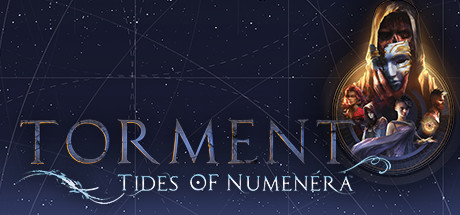

**Torment: Tides of Numenera is the spiritual successor to Planescape: Torment set in the far future world of Numenera, where you play the Last Castoff of an immortal being called the Changing God. Features the unique Tidal Affinity system and a deeply philosophical story.**

---

## 📖 About

Torment: Tides of Numenera is the spiritual successor to Planescape: Torment set in the far future world of Numenera, where you play the Last Castoff of an immortal being called the Changing God. Features the unique Tidal Affinity system and a deeply philosophical story.

## ⚠️ Problems Without Trainer

| Problem | Status |
|---------|--------|
| **Combat vs Persuasion** — Combat is often intentionally inferior to dialogue/skill resolutions | ✅ Solved |
| **Tide Alignment** — Choosing Tide affinities has unclear mechanical consequences for new players | ✅ Solved |
| **Crisis Mode** — Combat sequences require understanding the Effort and Pool expenditure systems | ✅ Solved |
| **Story Density** — Extensive reading required; players who skip text miss major story context | ✅ Solved |

## ✅ Solution

The **Torment: Tides of Numenera Trainer** solves all these issues by giving you complete control over the game.

## 🎯 Full Feature List

- Unlimited Resources
- God Mode / Invincibility
- Instant Skill Cooldown
- One-Hit Kill
- Freeze Game Timer
- Unlock All Items & Achievements
- Custom Speed Multiplier
- Save State Anywhere

## 🚀 Quick Start

1. **Disable Windows Defender** temporarily (trainer may trigger false positive)
2. Download the trainer from the button above
3. Launch Torment: Tides of Numenera
4. Run the trainer as Administrator
5. Activate desired cheats with hotkeys

## 💎 Free vs Paid

| Feature | Free | Pro |
|---------|------|-----|
| Basic God Mode | ✅ | ✅ |
| Unlimited Resources | ✅ | ✅ |
| All Advanced Cheats | ❌ | ✅ |
| Auto-Updates | ❌ | ✅ |
| Priority Support | ❌ | ✅ |

## 💻 Requirements

- Windows 10/11 (64-bit)
- Torment: Tides of Numenera (any version)
- .NET Framework 4.8+
- DirectX 11+

## 🍎 macOS

macOS users can use our alternative tool:

## ⚖️ Legal

This trainer is for educational and single-player use only. Use responsibly.

---

